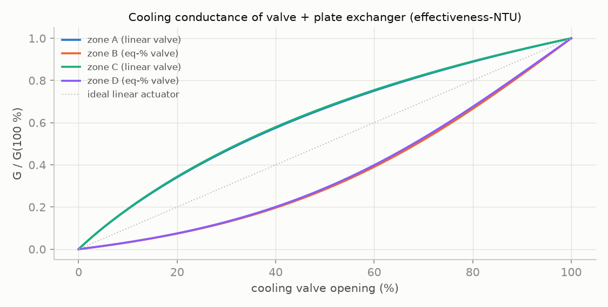

# One tuning for the whole operating envelope: split-range PID for the zones of a rubber-line temperature control unit

**Systems engineering dossier.** Pre-baseline draft, revision A, 11 Nov 2026.

This dossier follows C. S. Wasson, *System Engineering Analysis, Design, and Development* (2nd ed.,
Wiley 2016), cited as **[W]** with the printed page and then the PDF page. Reading notes are in
`docs/sources/`. Other sources are listed in section 15 and in `docs/sources/REFERENCES.md`, each with
its status: **[read]**, **[std]** (textbook, section named), **[derived]** (computed here) or
**[assumed]** (a sizing choice of this repo, listed in section 8.2 with its sensitivity).

The engineering work is in this repository:
- the zone physics (`src/tcutune/physics.py`, `plant.py`), identification and tuning tool
  (`identify.py`, `tuning.py`, `tool.py`, CLI `tcu-tune`);
- the cooling linearisation and the envelope analysis (`linearise.py`, `envelope.py`);
- the PLC code in `plc/` (SCL, compiled in TIA Portal V18);
- the study `scripts/run_study.py` → `results/study.md`, and the trade study `scripts/aoa.py` →
  `results/aoa.md`.

> **Status.** Everything is simulation plus a TIA Portal V18 compile. No data from a real TCU or line
> has been used, and no PLCSIM run has been made. The open items that need the plant are in section 12.

---

## 0. Summary of findings

All numbers are from simulation (section 8): four zones tuned by the tool from simulated technician
tests at one test point (80 °C, full process load, cooling water 15 °C), then checked on the true
linearised plant at about 150 envelope points per zone (setpoint 50–90 °C, load 0.5–1.5 × q_run,
cooling water 8–30 °C), clean and fouled, and in the time domain at a winter and a summer corner.
Source: `results/study.md` (sections in brackets) and `results/aoa.md`.

1. **The engineering question.** A split-range PI per zone holds well at some conditions and badly at
   others. What moves under the controller, and what is the smallest change that keeps one tuning
   robust (SPS-201: Ms ≤ 1.6) over the whole envelope?
2. **What moves (§4, the deciding parameter).** The cooling-path gain near the loop's crossover
   frequency, relative to the test point, spans **0.07–1.87**: a factor of **13.7–25** on zones with a
   linear (PWM) valve and **3.5–3.6** with an equal-percentage valve. Causes: the heat removed scales
   with Tw − Tcw (13–82 K over the envelope), and the plate exchanger's ε-NTU curve bends the valve
   characteristic. The heating path does not move.
3. **Alternatives (§5, §3).**

   | Alternative | Ms in cooling, clean (all zones) | points with Ms > 2 | summer load-step peak, zones A/B/D |
   |---|---|---|---|
   | A one gain set | 1.08–298 | 53–86 % | 0.9 / 1.5 / 2.2 K, but limit cycle (707 switchovers, zone A test point) |
   | B static gain ratio | 1.07–149 | 41–99 % | — |
   | C crossover ratio (v0.1) | 1.02–1.70 | 0 % (9–39 % below 1.2) | 2.9 / 2.9 / 4.2 K |
   | D C + Tw − Tcw scaling | 1.09–3.35 | 0–9 % | — |
   | **E C + exchanger/valve inversion (v0.2)** | **1.36–1.41** | 0 % | **1.7 / 1.1 / 2.2 K** |

   With the exchanger fouled and the model left clean, E stays at **1.19–1.33**: fouling only makes it
   more cautious.
4. **Why the obvious fix fails.** On the equal-percentage zones the static gain ratio is below 1 (0.49,
   0.75): the open valve adds conductance and lowers the static gain, while near crossover the cooling
   path is 2.4–2.6 × stronger than heating. B is worse than doing nothing there.
5. **A defect found by the corner runs.** With E, the valve can saturate before the PID's own cooling
   limit; the integrator wound up and the summer setpoint drop overshot by 1.6–1.8 K. Conditional
   integration from `FB_CoolLinearise.Saturated` brought it to 0.2–0.4 K (SPS-205).
6. **Feedforward (§6).** The mixer's 150 s batch cycle sits where feedback amplifies (|S| = 1.25;
   |S| > 1 for 38–224 s), so no retuning can attenuate it (Bode sensitivity integral [C3]). Feedforward
   from the rotor power halves the ripple, **0.8 → 0.4 K** peak-to-peak (0.4–0.5 K with ±30 % gain
   error). On the head zone with the sensor in the steel no cooling alternative meets the 2 K load-step
   limit (6.5 K with E); feedforward brings it to **2.6 K** (2.3–3.4 K with ±30 % error).
7. **Trade study (§10).** E 80.2, C 77.4, D 43.9, B 35.5, A 33.7. The margin is small: C wins when cost
   weighs 27 or more, or when the sensor and engineering cost doubles. Recommendation: **retune all zones
   with C now (no hardware); add the cooling-water sensor and E where the cooling water swings with the
   season or the valves are equal-percentage; feedforward on mixer and head zones.**
8. **PLC (§7).** All blocks compile in TIA Portal V18 with 0 errors and 0 warnings, OB30 at 100 ms;
   upper-bound 0.64 ms per zone per cycle, 15.4 ms for 8 zones with a 3× margin (15 % of the cycle).

---

## 1. Problem and stakeholders  ([W] ch. 4–5)

### 1.1 Problem statement

A rubber-compound line (internal mixers, cold-feed extruders, their heads and the conditioning
stations) holds the temperature of its machine parts with **temperature control units (TCUs)**. A TCU
has several independent water circuits (zones). Each zone heats with an electric heater and cools
through a cooling-water valve and a plate heat exchanger in its closed primary circuit. One PID per zone,
split-range between heater and valve, runs in a Siemens S7 PLC.

Problem statement in the form of [W] p.91–92/121–122 (one sentence, no cause, no solution, no blame):

> *Some TCU zones on the line hold their temperature well at some operating conditions and oscillate
> or respond slowly at others, and there is no method for setting their controllers that works for all
> zones and all conditions.*

The plant's own description says the current temperature control "is showing non-optimal behaviour in
some cases". The phrase "in some cases" is the starting point: a tuning that is bad everywhere is easy
to find and fix; one that is bad *somewhere* means the plant moves under the controller.

### 1.2 Stakeholders  ([W] Table 4.2, p.84–85/114–115)

| Role ([W] Table 4.2) | Who | Interest |
|---|---|---|
| User | line operators, process engineers | stable compound temperature, few alarms, quick start-up |
| End user | tyre building (the compound's customer) | consistent compound properties (temperature history affects scorch safety and viscosity) |
| Owner | plant | scrap, energy, availability |
| Maintainer | automation and maintenance technicians | one method for all TCUs, easy retuning after a repair, diagnosable faults |
| Developer | thesis student, automation group | PLC code that fits the existing S7 programs and cycle |
| Independent test | process engineering, quality | acceptance on the real line against the current settings |

### 1.3 Needs, measures of effectiveness and measures of performance  ([W] p.100–101/130–131, Fig. 5.8 p.116/146)

| Need | MOE ([W] P5.10) | Contributing MOPs |
|---|---|---|
| N1 compound temperature held in production | share of production time inside ±1 K | peak deviation after a load change; IAE; |
| N2 the same tuning works in every condition | worst-case robustness over the operating envelope | Ms in heating and in cooling at every envelope point, exchanger clean and fouled |
| N3 no oscillation, no valve or contactor wear | switchovers heater ↔ valve per hour | limit-cycle detection, valve travel |
| N4 one tool for all similar TCUs | technician time per zone | test duration, number of tests, no manual model fitting |
| N5 fits the existing PLC | no new hardware except where the analysis shows it pays | PLC time per zone; new signals |

MOS ([W] P5.11, p.115/145): the zone stays in automatic through the whole operating envelope without
operator retuning.

---

## 2. Concept of operations  ([W] ch. 6)

### 2.1 Mission and context

The mission of one TCU zone controller is to hold the temperature of its machine part at the setpoint
given by the recipe, across product changes, start-ups, process load changes and the seasons, with the
heater and the cooling valve it has, inside the PLC cycle it has.

```
            recipe setpoint                 cooling water (8-30 degC over the year)
                  |                                   |
   +--------------v------------------+     +----------v-----------+
   | PLC: FB_ZonePID -> FB_CoolLinearise|--->| valve -> plate exchanger |--+
   |      (split range, anti-windup)    |    +-----------------------+   |  closed primary
   |                 \---- heater % ----------> heater (9-24 kW) ---------+  water circuit
   +--------------^------------------+                                  |  (pump 30-80 l/min)
                  | PV (water return or part sensor)                    v
                  +------------------------------------ machine part (barrel / screw / head / mixer wall)
                                                          ^  process heat from the compound (7-17 kW)
```

The technician's part of the mission is the **tuning tool** (`tcu-tune`): three short tests per zone
(heater step, cooling step with the machine running, optional relay test), recorded as CSV from a
trace, give the recommended `FB_ZonePID` and `FB_CoolLinearise` settings.

### 2.2 Phases and use cases  ([W] P5.7 p.110/140; UC principles p.120–122/150–152; Table 6.4 p.143/173)

| Phase | Use case | Actor | Trigger | Outcome |
|---|---|---|---|---|
| Pre-mission | UC1 commission or retune a zone | technician | new TCU, repair, recipe range change | tests recorded, settings loaded, acceptance run done |
| Pre-mission | UC2 enter the TCU nameplate data | technician | first commissioning of a TCU type | exchanger UA, flows, valve type in `FB_CoolLinearise` |
| Mission | UC3 cold start to setpoint | operator | shift start | setpoint reached without overshoot beyond limit |
| Mission | UC4 production with process load | line | extruder/mixer running | zone in cooling, within ±1 K |
| Mission | UC5 recipe change (setpoint step) | recipe system | product change | new setpoint, bounded overshoot |
| Mission | UC6 batch load (mixer) | mixer cycle | every 2–4 min | periodic load absorbed |
| Mission | UC7 sensor or actuator fault | PLC | plausibility | defined degraded mode (section 3) |
| Post-mission | UC8 cleaning of the exchanger | maintenance | fouling, valve near 100 % | UA restored, no retuning needed |

---

## 3. Modes and states  ([W] ch. 7)

Modes follow [W] Table 7.3 (p.162/192) and the transition table form of Table 7.1 (p.158/188).

| Mode | What runs | Entered by | Left by |
|---|---|---|---|
| M0 Off / Reset | outputs 0, integrator cleared | `Reset` | `Reset` released |
| M1 Manual | output = `ManualValue`, integrator tracks (bumpless) | `ManualEnable` | `ManualEnable` released |
| M2 Auto, heating | split range u ≥ 0 → heater | u ≥ deadband | u < −deadband |
| M3 Auto, cooling | split range u < 0 → cooling demand → linearisation → valve | u ≤ −deadband | u > deadband |
| M3a Cooling saturated | valve 100 %, PID stops integrating into cooling (conditional integration) | `FB_CoolLinearise.Saturated` | demand back inside capacity |
| M3b Cooling-water sensor fault | last valid Tcw held | `TcwValid` = FALSE | sensor valid |
| T Test (commissioning) | tool test sequences (manual steps, relay) | technician | test end |

Prohibited actions ([W] P7.10, p.169/199): no heater and valve on at the same time (the split range has
one sign); no integration into a saturated valve; no change of `Mode`/ratio while in cooling without
going through Manual.

---

## 4. Requirements  ([W] ch. 19–22)

Requirements are written in the style of [W] ch. 20–22 (one per statement, verifiable, solution-free
where possible; P19.6, p.401/431) with verification methods I/A/D/T ([W] p.270–272/300–302). Values
marked **TBD** need the plant (section 12).

### 4.1 Mission and operational performance (spec §3.1–3.2)

| ID | Requirement | Threshold / objective | Source | Verif. |
|---|---|---|---|---|
| SPS-101 | In steady production the zone temperature shall stay within ±1 K of the setpoint. | ≥ 99 % of time / ≥ 99.9 % | N1; TCU control accuracy class ±0.5–1 K [assumed], TBD-1 with the plant | A, T |
| SPS-102 | After a process-load step of q_run the peak deviation shall not exceed | 2.0 K / 1.5 K | N1 [assumed] | A, T |
| SPS-103 | A setpoint step of −5 K in the cooling range shall overshoot by no more than | 1.0 K / 0.5 K | N1, UC5 [assumed] | A, T |
| SPS-104 | In steady production there shall be no sustained heater ↔ valve limit cycle (valve cycling between closed and fully open). | none / none | N3, contactor and valve life | A, T |
| SPS-105 | With a batch load (mixer), the periodic temperature ripple shall not exceed | ±0.5 K / ±0.25 K | N1, UC6 [assumed] | A, T |

### 4.2 Capabilities (spec §3.3)

| ID | Requirement | Threshold / objective | Source | Verif. |
|---|---|---|---|---|
| SPS-201 | One set of controller settings per zone shall keep Ms ≤ 1.6 (objective 1.4 ± 0.1) in heating and in cooling at every point of the operating envelope: setpoint 50–90 °C, process load 0.5–1.5 × q_run, cooling water 8–30 °C, exchanger clean to fouled (Rf = 0.000176 m²K/W). | Ms ≤ 1.6 / 1.3–1.5 | N2 [C1: Ms 1.2–2.0 usual] | A |
| SPS-202 | The tuning tool shall produce the settings from a heater step, a cooling step with the machine running and an optional relay test, without manual model fitting. | ≤ 3 h test time per zone | N4 | D |
| SPS-203 | The tool shall refuse rules whose model assumptions do not hold (e.g. FOPDT rules when no dead time is visible). | always | N4 | T |
| SPS-204 | Manual ↔ automatic shall be bumpless. | step ≤ 0.5 % | N3 [C1] | T |
| SPS-205 | When the cooling valve is fully open before the PID reaches its own cooling limit, the PID shall stop integrating into cooling. | always | SPS-103 (windup) | T |
| SPS-206 | A cooling-water temperature sensor fault shall not move the valve. | hold last valid value | FMEA F3 | T |

### 4.3 Interfaces (spec §3.4)

| ID | Requirement | Source | Verif. |
|---|---|---|---|
| SPS-301 | The controller shall use the existing zone temperature, the TCU water temperature, heater and valve outputs, and at most **one new signal per TCU**: the cooling-water supply temperature. | N5 | I |
| SPS-302 | Optional feedforward shall use a process-power signal that the line PLC already has (extruder drive power, mixer rotor power). | N5 | I |

### 4.4 Operating environment (spec §3.5)

Cooling water from a cooling-tower circuit, 8–30 °C over the year [assumed, TBD-2]; ambient 15–35 °C;
setpoints 50–90 °C (water TCU without pressurisation above 95 °C [assumed]).

### 4.5 Design and construction constraints (spec §3.6)

| ID | Requirement | Verif. |
|---|---|---|
| SPS-361 | Siemens S7-1500, SCL, TIA Portal V18: 0 errors and 0 warnings. | T (compile) |
| SPS-362 | Execution of all zone blocks shall stay below 20 % of the 100 ms OB30 period with a 3× margin ([W] p.669). | A, T (CPU statistics) |
| SPS-363 | The SCL source executed in CI shall match the Python reference (bit-exact for FB_ZonePID; ≤ 0.01 % valve for FB_CoolLinearise; ≤ 0.05 K closed loop). | T |

---

## 5. Architecture  ([W] ch. 26)

The architecture separates what changes with the plant from what changes with the zone ([W] ch. 26,
functional allocation). One zone is three PLC blocks plus the simulation blocks used for tests:

| Element | Function | Allocated requirements |
|---|---|---|
| `FB_ZonePID` (v0.2) | split-range PI(D) in heating-equivalent %: setpoint weighting, filtered derivative on the measurement, back-calculation anti-windup, bumpless manual, **lagged feedforward input**, **conditional integration when the cooling valve saturates**, `CoolGainRatio` | SPS-101…105, 204, 205 |
| `FB_CoolLinearise` (new) | turns the PID's cooling demand into a valve opening: mode 0 none, mode 1 Tw−Tcw scaling, **mode 2 inversion of the valve + plate-exchanger model (ε-NTU) by bisection**; holds the last valid Tcw on a sensor fault; reports saturation | SPS-201, 205, 206, 301 |
| `tcu-tune` (Python tool) | identification (FOPDT, lead-lag with dead time, relay), rule selection with Ms check, crossover cooling ratio; with mode 2 active the cooling test is recorded through the linearisation | SPS-202, 203 |
| `FB_ZonePlant`, `FB_Scenario`, `FB_ZoneTest`, OB30 | simulation of a zone in the PLC (no hardware) for PLCSIM and CI equivalence tests | SPS-363 |

```
 Setpoint, PV ──► FB_ZonePID ──u ≥ 0──► heater %
                      │  ▲
                      │  └── CoolSaturated (last cycle)
                      └─u < 0── cooling demand c % ──► FB_CoolLinearise ──► valve %
                                                         ▲      ▲
                               TCU water temperature Tw ─┘      └─ cooling-water temperature Tcw (new sensor)
 process power (drive) ─► × FfGain ─► FeedForward (lag FfTime) ─► FB_ZonePID
```

Why the linearisation sits outside the PID: the PID stays the plant's standard split-range block
(retuning keeps its meaning), and the valve/exchanger knowledge, which belongs to the TCU type, is
entered once per TCU type from the nameplate (UC2).

---

## 6. Interfaces  ([W] ch. 27)

### 6.1 Ownership

The zone blocks are owned by the line PLC program. The tool is owned by maintenance. The TCU
nameplate data are owned by the TCU supplier documentation.

### 6.2 Interface table

| ID | From → to | Signal | Type, unit, range | Rate | Status |
|---|---|---|---|---|---|
| IF-1 | zone sensor → FB_ZonePID.Input | zone temperature (water return or steel) | Real, °C, 0–150, 0.1 K resolution | 100 ms | existing |
| IF-2 | TCU water sensor → FB_CoolLinearise.Tw | primary-circuit water temperature | Real, °C | 100 ms | existing in every TCU (its own control sensor) |
| IF-3 | new Pt100 → FB_CoolLinearise.Tcw (+ TcwValid) | cooling-water supply temperature | Real, °C, 0–50; validity from the AI channel diagnostics | 100 ms (changes in hours) | **new, one per TCU** |
| IF-4 | FB_ZonePID.OutHeat → heater | heater demand | Real, %, 0–100 → SSR/thyristor or PWM contactor | 100 ms | existing |
| IF-5 | FB_CoolLinearise.Valve → valve | valve opening | Real, %, 0–100 → proportional valve or PWM solenoid | 100 ms | existing |
| IF-6 | drive → FB_ZonePID.FeedForward | process power × FfGain | Real, heating-equivalent % | 100 ms | existing signal, new use (optional) |
| IF-7 | FB_CoolLinearise.Saturated → FB_ZonePID.CoolSaturated | saturation flag | Bool | 100 ms | internal |
| IF-8 | trace (CSV) → tcu-tune | t_s, heat_pct, cool_pct, pv_degC | CSV, 1 s | per test | tool input |
| IF-9 | tcu-tune → DB | Gain, Ti, Td, CoolGainRatio, Mode, DTref, UA, CsMax, Cp, ValveR, FfGain, FfTime | Real | per commissioning | tool output |

---

## 7. Performance budgets and margins  ([W] ch. 31)

### 7.1 PLC cycle-time budget  ([W] P31.4 apportionment, p.668; frame-based systems, p.679/709)

Static upper bound: every arithmetic and comparison operator in the SCL body, FOR bodies multiplied by
their trip count, all branches counted, × the CPU 1513-1 PN typical times [P1] (256 ns per float
operation, 48 ns per word operation), EXP and LN counted as 20 float operations each [assumed].
Source: `results/study.md` §7.

| Block | float ops | word ops | time |
|---|---|---|---|
| FB_ZonePID | 52 | 45 | 15.5 µs |
| FB_CoolLinearise (mode 2, 16 model evaluations) | 2365 | 455 | 627 µs |
| per zone | | | **0.64 ms** |
| 8 zones with a 3× margin ([W] p.669) | | | **15.4 ms = 15 % of the 100 ms OB30** (SPS-362: ≤ 20 %) |

The linearisation dominates. If a CPU runs short, the inversion can run every 5th cycle (Tw and Tcw
change over tens of seconds) or with 12 instead of 16 evaluations (valve resolution 0.05 %), cutting it
by 80 % or 25 %. Neither is needed at the estimated load. On-target timing is VT-7.

### 7.2 Temperature error budget at a load step (zone B, test point, E)

| Contribution | Value | Source |
|---|---|---|
| sensor resolution | 0.1 K quantisation | assumed AI card |
| noise | 0.05 K 1σ | assumed |
| dynamic deviation after a full load step | 0.9 K peak | `results/study.md` §3 |
| total against the 2 K limit (SPS-102) | ≈ 1.0 K | margin about 1 K |

### 7.3 Robustness margin  ([W] P31.5)

| Item | Allocation | Achieved with E (clean / fouled) | Source |
|---|---|---|---|
| Ms in heating | ≤ 1.4 (tool target) | 1.36–1.40 | §3 |
| Ms in cooling over the envelope | ≤ 1.6 (SPS-201) | 1.36–1.41 / 1.19–1.33 | §5 |
| model error of the linearisation | stay ≤ 1.6 | exchanger UA 47 % below the model (fouled): Ms moves 1.36–1.41 → 1.19–1.33, i.e. towards caution | §5 |

---

## 8. Modelling and simulation  ([W] ch. 33)

### 8.1 Intended use and fidelity  ([W] P33.1, p.706/736; fidelity matrix, p.708/738)

**Intended use:** compare cooling-path alternatives and tuning rules on their robustness over the
operating envelope, and produce realistic step-test records for the tool. **Not** intended for:
absolute temperatures of a real line, valve sizing, or proving SPS-101 (that needs the line trial,
section 11.3).

| Effect | Modelled | How | Fidelity |
|---|---|---|---|
| water and steel heat capacity | yes | two lumped masses | medium: one steel mass per zone, no axial gradient |
| channel film coefficient | yes | Gnielinski at the design flow [H1 eq. 8.62] + steel conduction in series | medium |
| plate exchanger | yes | ε-NTU counterflow, cooling-side film ∝ flow^0.8 [H1, H2] | medium |
| cooling-water valve | yes | linear (PWM solenoid) or equal-percentage R = 30 [V1] | medium; no hysteresis, no PWM ripple |
| transport delay, sensor lag | yes | plug-flow volume / pump flow; first-order lag | medium |
| process heat from the compound | yes, as an input | step (extruder) or square-wave batch cycle (mixer) | low: amplitude assumed, section 8.2 |
| fouling | yes | UA / (1 + U·Rf) [H3] | order of magnitude |
| sensor noise and resolution | yes | 0.05 K white noise, 0.1 K quantisation | typical analog input card |
| property change with temperature | no | properties at 80 °C | a few % on UA over 50–90 °C |
| boiling, pressurisation, pump curve | no | — | outside the 50–90 °C range |

Verification of the model itself (tests): steady state against a 1 h simulation (< 1e-6 K), Euler
step 0.1 s against 0.01 s (< 0.02 K), linearisation against the numerical DC gain, closed-form FRF
against the matrix FRF (< 2e-3), and the SCL twin FB_ZonePlant within 0.01 K of the Python model.

### 8.2 Sourced vs assumed parameters

| Parameter | Value(s) | Status | Sensitivity run |
|---|---|---|---|
| water properties, steel cp and k | Table A.1/A.6 | [std] [H1] | — |
| Gnielinski, ε-NTU, Re^0.8 | relations | [std] [H1, H2] | — |
| heater power | 9 / 12 / 18 / 24 kW | [assumed] water-TCU class | the tool re-identifies, so only ratios matter |
| pump flow | 30–80 l/min | [assumed] | enters L and Cp |
| exchanger UA at full cooling flow | 0.6–2.6 kW/K | [assumed], sized so q_run needs 9–40 % valve | fouled case (UA −47 %) |
| valve type | A, C linear (PWM); B, D equal-% R = 30 | [assumed] | both types are in the set |
| hoses, channels, steel mass | `physics.PRESET_DESIGNS` | [assumed] machine class | four zones span Cm 87–414 kJ/K |
| outer film 11 W/m²K | | [std] estimate [H1 ch. 9] | small effect (UAloss 0.03–0.09 kW/K) |
| sensor lag 3–6 s | | [assumed] | — |
| process heat q_run 7–17 kW | | [derived/assumed]: about 40 % of the 89 kW compound heating power of the project-12 extruder [R1] shared over its zones; mixer wall share assumed | envelope 0.5–1.5 × q_run |
| cooling water 8–30 °C | | [assumed] cooling-tower circuit | an envelope axis |
| fouling Rf 0.000176 m²K/W, U_clean 5000 W/m²K | | [std] TEMA order of magnitude [H3]; U [assumed] | clean vs fouled |
| mixer cycle 150 s, rotors loaded 65 %, ±0.6 q_run | | [assumed] | the |S| curve covers 38–600 s |
| Ms targets 1.4 / 1.6 | | [std] [C1] | — |

### 8.3 Why "in some cases" (finding)

The model makes the cause of "in some cases" concrete. Around the loop's crossover the PID sees the
cooling path as `b = dPc/dvalve = (dG/dvalve)·(Tw − Tcw)` together with an extra conductance `G(valve)`
that speeds up the water mass. Both move:

- **Tw − Tcw** spans 13–82 K over setpoint 50–90 °C and cooling water 8–30 °C, a factor of about 6;
- **dG/dvalve** of the valve + exchanger falls with the opening on a linear (PWM) valve, because ε of
  the exchanger saturates as the cooling flow rises; on an equal-percentage valve the rising valve
  slope partly cancels that (`docs/img/exchanger_characteristic.png`).

The product moves by 13.7–25 × (linear valves) and 3.5–3.6 × (equal-percentage) relative to the test
point (`results/study.md` §4). A PI tuned at the test point therefore meets at least one corner where it
is either aggressive (winter, hot setpoint, low opening) or sluggish (summer, cool setpoint). The heating
path has neither effect, which is why the same zone looks fine while it heats.



### 8.4 Plant set for design

The four zones are four different machine parts on purpose: two sensor positions (water, steel), two
valve types, Cm 87–414 kJ/K, dead time 5.7–14.2 s, process heat 7–17 kW. The tool is tuned on each by
its own simulated tests, so the result is a statement about the method across "similar TCUs", which is
what the topic asks for.

---

## 9. Reliability, failure modes and the FMEA  ([W] ch. 34)

### 9.1 What counts as a failure

A failure of the zone control is any event that breaks SPS-101…105: an oscillation (limit cycle), a
deviation beyond the limits, or an actuator held at a limit. Hardware failures of the TCU (heater,
pump) are handled by the TCU's own protection and are out of scope; their effect on the controller is
listed.

### 9.2 FMEA  ([W] ch. 34; severity S, occurrence O, detection D on 1–10 scales, RPN = S·O·D)

| ID | Failure mode | Effect | Cause | S | O | D | RPN | Mitigation in this design | RPN after |
|---|---|---|---|---|---|---|---|---|---|
| F1 | PID in cooling with one gain set | limit cycle, valve and contactor wear | cooling path several times stronger than heating near crossover | 6 | 7 | 5 | 210 | crossover ratio (C) or linearisation (E) | 60 |
| F2 | cooling gain drifts with season and setpoint | slow or oscillating zone "in some cases" | Pc ∝ (Tw − Tcw); valve and exchanger nonlinear in the opening | 5 | 7 | 7 | 245 | FB_CoolLinearise mode 2 | 50 |
| F3 | cooling-water sensor fails | wrong valve demand | wire break, AI fault | 6 | 3 | 3 | 54 | hold the last valid Tcw (`TcwValid`), alarm | 36 |
| F4 | valve saturates before the PID's own limit | integrator windup, overshoot after a load drop | linearised demand above exchanger capacity | 5 | 4 | 6 | 120 | conditional integration (`CoolSaturated`) | 40 |
| F5 | exchanger fouls | less cooling gain, then loss of capacity | scale, biofilm | 4 | 6 | 6 | 144 | the robustness margin covers it (Ms only falls); time in `Saturated` as a cleaning indicator | 72 |
| F6 | wrong nameplate data in FB_CoolLinearise | gain error | entry error; valve replaced by another type | 5 | 3 | 6 | 90 | `tcu-tune nameplate` print-out; the cooling step through the linearisation measures the result | 45 |
| F7 | zone sensor fails | wrong PV | Pt100 break | 8 | 3 | 2 | 48 | existing TCU limit thermostat; PV plausibility (TBD-5) | — |
| F8 | feedforward signal wrong | offset or extra disturbance | drive signal scaling | 4 | 3 | 5 | 60 | the PID corrects it; ±30 % error is still better than none (section 0) | 48 |
| F9 | heater SSR stuck on | overheating | SSR failure | 9 | 2 | 3 | 54 | TCU over-temperature cut-out (hardware), out of scope | — |

### 9.3 Availability

The software adds no new single point of failure except the Tcw sensor, and its failure (F3) degrades
to "temperature scaling frozen", not to a stop. Automatic-mode availability therefore stays set by the
existing TCU hardware.

---

## 10. Analysis of alternatives  ([W] ch. 32)

The AoA follows [W] ch. 32: alternatives, criteria and weights fixed first, utility curves stated,
then a sensitivity check. Script: `scripts/aoa.py`, output `results/aoa.md`.

### 10.1 Alternatives

| Key | Cooling path | New hardware | Engineering per TCU |
|---|---|---|---|
| A | one gain set (CoolGainRatio = 1) | none | none |
| B | static gain ratio from the cooling step | none | 1 test |
| C | ratio at the crossover frequency (tool v0.1) | none | 1 test |
| D | C + valve scaled by DTref / (Tw − Tcw) | cooling-water Pt100 | sensor + test |
| E | C + valve + exchanger model inversion (tool v0.2) | cooling-water Pt100 | sensor + nameplate data + test |

### 10.2 Criteria, weights and results

| Criterion (weight) | Measure | A | B | C | D | E |
|---|---|---|---|---|---|---|
| robustness (30) | worst Ms over the envelope, clean and fouled | 298 | 149 | 1.70 | 3.35 | 1.41 |
| corner performance (25) | mean load-step peak / SP-down overshoot at the corners (B, D: test point only) | 2.49 / 1.80 K | 1.77 / 2.58 K | 4.14 / 0.55 K | 2.70 / 0.75 K | 3.26 / 0.54 K |
| consistency (15) | mean Ms spread (max − min) per zone | 57.9 | 65.9 | 0.48 | 0.71 | 0.04 |
| actuator wear (10) | heater/valve switchovers per run | 129 | 80 | 26 | 26 | 39 |
| cost (15) | sensor + engineering per TCU (assumed 250 EUR sensor, 60 EUR/h) | 0 | 0 | 240 | 610 | 970 EUR |
| PLC load (5) | budget §7 | low | low | low | low | 0.64 ms/zone |
| **figure of merit** | | **33.7** | **35.5** | **77.4** | **43.9** | **80.2** |

The exact measures and utility scores are in `results/aoa.md`. A's low load-step peaks come from its aggressive
cooling gain and are paid for with limit cycles and SP-down overshoots of up to 6.4 K. Corner performance
scores C and E almost equal on average, because the head zone (sensor in the steel) dominates both
means; the separation is at the summer corner of the extruder zones (2.9 K for C vs 1.1–1.7 K for E).

### 10.3 Sensitivity

- Every weight ±10 points, one at a time: E wins 10 of 12 cases; C wins when consistency loses 10
  points or PLC load gains 10 (by 0.1).
- Cost doubled: C wins (76.2).
- Cost weight at which E stops winning: 27 of 100.

### 10.4 Recommendation

The ranking is close and the reason is clear: E buys uniform robustness with one sensor per TCU and
the exchanger data; C already removes the instabilities for free. Recommendation, in order:
1. retune every zone with the tool's crossover ratio (C) — no hardware, removes A's limit cycles;
2. add the cooling-water sensor and E on TCUs whose cooling water swings with the season or whose
   valves are equal-percentage, where C becomes slow;
3. add power feedforward on mixer and head zones (section 0, item 6);
4. design a cascade on the water temperature for zones with the sensor in the steel (section 13).

---

## 11. Verification and validation  ([W] ch. 13, 28)

### 11.1 Requirements verification traceability matrix  ([W] Table 22.3, p.458)

The full matrix with code and test locations is in `TRACEABILITY.md`.

| Req. | Method | Result (simulation) | Status |
|---|---|---|---|
| SPS-101 ±1 K | A + T | not evaluated as a time share: the study runs scenarios, not production weeks | open (VAL-1) |
| SPS-102 load step ≤ 2 K | A | E: 0.9–1.7 K on zones A, B; 1.8–2.2 K on the mixer zone D; head zone C 6.5 K (2.6 K with feedforward) | met on A, B; D misses at the corners by 0.2 K; C not met (section 13) |
| SPS-103 SP-down ≤ 1 K | A | C: 0.0–0.9 K; E: 0.2–0.7 K on A, B, D and 1.2 K on the head zone C; A: up to 6.4 K | C met; E met except the head zone; A, B not |
| SPS-104 no limit cycle | A | A: 707 switchovers with the valve slamming 0–100 % (zone A test point); C, E: 2–122 sign changes per run from noise near zero output, no valve cycling | C, E met; A, B not |
| SPS-105 batch ripple ≤ ±0.5 K | A | ±0.4 K without, ±0.2 K with feedforward | met |
| SPS-201 Ms ≤ 1.6 over the envelope | A | E 1.36–1.41 (fouled 1.19–1.33); C up to 1.61–1.70 | E met; C misses by 0.01–0.10 at a few corner points of every zone |
| SPS-202/203 tool | D, T | pytest `test_cli.py`, `test_rules_reject_missing_dead_time` | met |
| SPS-204/205 bumpless, conditional integration | T | pytest, SCL bit-exact | met |
| SPS-206 Tcw fault hold | T | pytest on the SCL | met |
| SPS-301/302 signals | I | section 6.2 | met |
| SPS-361 TIA V18 0/0 | T | 0 errors, 0 warnings incl. OB30 | met |
| SPS-362 ≤ 20 % of OB30 | A | 15 % (upper bound, 8 zones, 3× margin) | A met; T open (VT-7) |
| SPS-363 SCL = reference | T | bit-exact / ≤ 0.01 % / ≤ 0.05 K | met |

### 11.2 What has been verified in this repository

- **Unit and equivalence tests** (`pytest`, run in CI on every push):
  - physics: water table, ε-NTU limits, valve end points, Gnielinski range, derived presets physical;
  - plant: steady state, Euler accuracy, linearisation; identification and the rules; the tool end to end;
  - the PID, including conditional integration;
  - the SCL source executed in float32 against the Python references: `FB_ZonePID` bit-exact with
    manual, reset, feedforward and the saturation flag; `FB_CoolLinearise` within 0.01 % valve in all
    three modes on three zones; the whole SCL loop (`FB_ZoneTest`) within 0.05 K of the Python loop, with
    and without linearisation and feedforward.
- **TIA Portal V18 compile** through Openness, CPU 1513-1 PN FW 2.9: all FBs, the DBs and OB30 at
  100 ms, 0 errors, 0 warnings (`results/tia_compile*.txt`, `docs/img/tia_FB_CoolLinearise.png`).
- **Analysis** (`scripts/run_study.py`): envelope Ms, corners in the time domain, batch load, budget.
- **Not verified here:** a PLCSIM run (S7-PLCSIM V18 is not installed; its installer is on the PC but
  stops on a pending Windows restart), execution time on a real CPU, any real TCU.

### 11.3 Line-trial plan (validation)  ([W] P13.13, p.284/314; ch. 28)

The acceptance criteria are set before the trial ([W] P13.13).

| Step | What | Pass criterion |
|---|---|---|
| VT-1 | Record the current settings and one week of trends for 4 zones, one of each type | data complete |
| VT-2 | Enter the nameplate data (`tcu-tune nameplate` format), install the Tcw sensor | reading within ±0.5 K of a reference thermometer |
| VT-3 | Heater step, cooling step (through FB_CoolLinearise) and relay test per zone | tool report produced; every FOPDT refusal explained |
| VT-4 | Load the recommended settings into the existing FB on one zone; compare a load change and a setpoint step with VT-1 | SPS-102, 103 met, or better than the current settings |
| VT-5 | Switch on FB_CoolLinearise mode 2; repeat VT-4 in a cold-water week and a warm-water week | switchovers within SPS-104; no slow response in the warm week |
| VT-6 | Mixer zone: feedforward on and off on alternate days | ripple at the batch period reduced |
| VT-7 | CPU cycle statistics with all zones | SPS-362 |
| VAL-1 | Process engineering compares compound-temperature records over one month | SPS-101 met, accepted by the independent tester ([W] P13.15) |

---

## 12. TBD register and questions for the plant

| ID | Item | Why it matters | Who |
|---|---|---|---|
| TBD-1 | The real temperature tolerance per zone (±1 K assumed) | sets SPS-101/102 | process engineering |
| TBD-2 | Cooling-water circuit: tower or chiller, temperature range over the year | the envelope axis behind F2 | utilities |
| TBD-3 | TCU type, exchanger data sheet (UA or kW at given flows), valve type (PWM solenoid or proportional, Kvs, characteristic) | FB_CoolLinearise inputs | maintenance, supplier |
| TBD-4 | The current PID settings and how the cooling output is scaled today (one gain set?) | baseline for VT-4 | automation |
| TBD-5 | Is the zone sensor in the water or in the steel; is the TCU water temperature available in the PLC | lead-lag vs FOPDT; the Tw input | automation |
| TBD-6 | Which process-power signals exist (extruder drive, mixer rotor power) | feedforward | automation |
| TBD-7 | Which zones show the "non-optimal behaviour", and when (season, product) | confirms or rejects the envelope explanation | operators |
| TBD-8 | Trends of heater and valve outputs during an episode | tells a limit cycle (F1) from a slow response (C in summer) | automation |

---

## 13. Limits of this work

- **Simulation only.** The hardware values are sizing assumptions for this machine class (section
  8.2). The relations are textbook, but the numbers will move with the real TCUs; the method is what
  carries over.
- **Two lumped masses per zone.** A barrel zone has an axial temperature profile and couples to its
  neighbours; here the neighbours are a fixed conductance.
- **The head zone C (sensor in the steel)** misses SPS-102 with every cooling alternative: a 14 kW load
  step goes straight into the steel where the sensor is, and the water can only act through the
  steel-to-water lag. Feedforward from the process power cuts the deviation (section 0), but the peak
  stays above 2 K. A cascade on the TCU water temperature is the next design step and is not built
  here (decision D6). A real head load also rises with screw speed rather than as a step.
- **The linearisation needs the exchanger model.** The fouled case shows it degrades gracefully (Ms only
  falls), but a wrong valve type in the nameplate data would bias the gain (F6).
- **PLCSIM and on-target timing** are not done; the budget is a static upper-bound count.
- **No real line data.** All findings are hypotheses for the line trial (11.3).

---

## 14. Decision log

| ID | Decision | Alternatives considered | Reason |
|---|---|---|---|
| D1 | Derive the zone parameters from hardware (`physics.py`) | keep the v0.1 invented presets | the plant can replace each assumed value with a nameplate value; the method then carries over |
| D2 | Model the cooling as valve + plate exchanger (ε-NTU) in a closed primary circuit | bilinear direct-cooling law | the topic describes a closed primary circuit; ε-NTU makes the valve gain depend on the opening, the second cause of "in some cases" |
| D3 | Linearise outside the PID, in a new FB | gain-schedule the PID parameters | the plant's PID block stays standard; valve and exchanger knowledge belongs to the TCU type and is entered once |
| D4 | Bisection with 16 model evaluations for the inversion | lookup table; Newton | G(v) is monotonic, so bisection cannot fail and has a fixed cost; a table needs a staircase test per TCU |
| D5 | Conditional integration from the linearisation's saturation flag | ignore it | in the summer corner the valve saturated before the PID's own limit and the integrator wound up |
| D6 | No cascade for the steel-sensor zone in this revision | cascade on Tw | outside the cooling-path question; recorded as the next step (section 13) |
| D7 | `100.0 * 0.5 * (…)` rewritten as `50.0 * (…)` | — | TIA V18 folds the constant product into an LReal and warns that accuracy may be lost (warning in line 78); found by compiling six variants of the block |
| D8 | Hold the last Tcw on a sensor fault | fall back to mode 0 | mode 0 needs a different CoolGainRatio; Tcw moves over hours, so holding it is safe |

---

## 15. References

See `docs/sources/REFERENCES.md` for the full list with source status. Short keys used here: [W]
Wasson; [H1] Bergman/Incropera heat transfer; [H2] Shah & Sekulić; [H3] TEMA fouling table; [V1]
ISA-75.11.01; [R1] project 12 extruder model; [R2] White, rubber processing; [C1] Åström & Hägglund;
[C2] Skogestad SIMC; [C3] Skogestad & Postlethwaite; [C4] Shinskey; [C6] Ljung; [P1] CPU 1513-1 PN data
sheet; [P2] TIA Portal V18.
