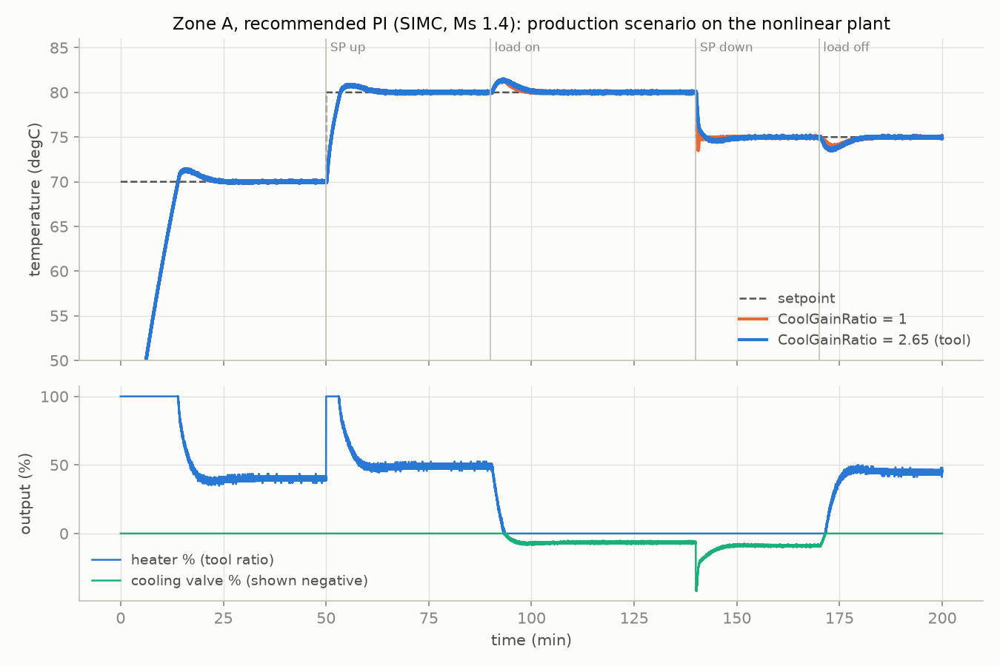
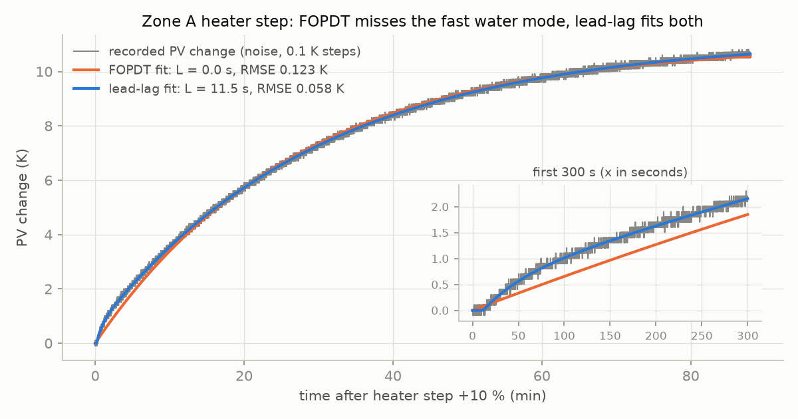
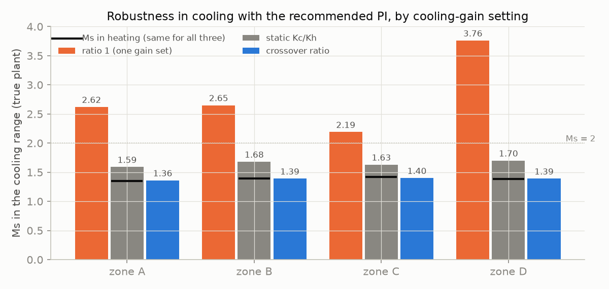
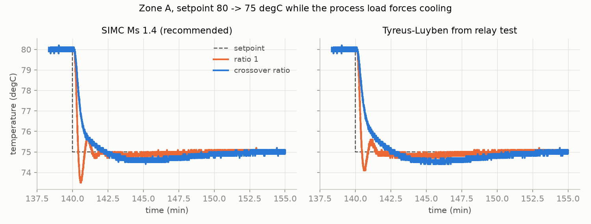
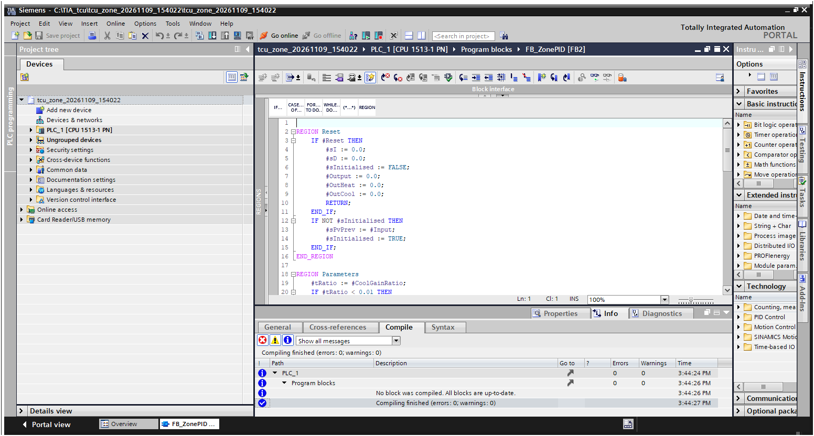

# tcu-zone-pid-tuning

Identification and PI tuning for the zones of a heating/cooling **temperature
control unit (TCU)**, with the controller written as a **Siemens SCL function
block** and the SCL source executed and checked against a Python reference.

Everything here runs on **simulated zones**. No data from a real machine is used.
See [SPEC.md](SPEC.md) for the requirements and their test status.



## What it does

1. **Simulates a TCU zone** (`src/tcutune/plant.py`). The model has two thermal
   masses: the circulating water and the machine part. It has an electric heater, a
   cooling valve whose effect grows with (water − cooling-water) temperature, transport
   dead time, sensor lag, 0.05 K noise and 0.1 K resolution. There are four preset
   zones of different size.
2. **Records the tests a technician would run on the machine**: a heater step, a
   cooling-valve step while the process puts heat in, and a relay test. They are
   saved as plain CSV.
3. **Identifies the zone** (`identify.py`) with a FOPDT model (two-point and least
   squares) and a five-parameter lead-lag model with dead time.
4. **Tunes the loop** (`tuning.py`, `tool.py`). It applies Ziegler–Nichols, SIMC, lambda,
   AMIGO, Tyreus–Luyben (relay), and SIMC on the lead-lag model with τc chosen so
   that **Ms ≤ 1.4**. Every candidate is reported with its robustness in the heating
   and the cooling range.
5. **Runs the controller as SCL.** `plc/FB_ZonePID.scl` is a split-range heat/cool PI(D)
   with setpoint weighting, filtered derivative on the measurement, back-calculation
   anti-windup, bumpless manual/auto and a `CoolGainRatio` input. `FB_ZonePlant`,
   `FB_Scenario` and `FB_ZoneTest` let the whole loop run in S7-PLCSIM with no
   hardware.
6. **Checks the SCL in CI.** `src/tcutune/scl.py` translates the SCL subset used here
   into Python with S7 data types (Real = IEEE float32). The tests run the **same source
   text** that goes into TIA Portal and compare it with the Python reference.
   `FB_ZonePID` is bit-exact.

## Results (from `scripts/run_study.py`, full tables in [results/study.md](results/study.md))

**1. Textbook FOPDT rules fail on three of the four zones.** On zones where the sensor
is in the water (A, B, D), the fast water loop hides the dead time. The least-squares
FOPDT fit returns L = 0 s, and ZN, SIMC and AMIGO would give infinite gain. The tool
reports these rules as *not applicable* instead of printing numbers. The lead-lag fit
recovers the dead time (zone A: 11.5 s against a true 8 s transport delay plus 4 s
sensor lag) and halves the fit error (0.058 K vs 0.123 K RMSE).



**2. One set of gains for heating and cooling loses its robustness in cooling.** The
cooling valve is 2.5–2.9 times stronger than the heater around the loop's crossover
frequency. On the true linearised plant, the recommended PI has Ms 1.35–1.42 in
heating, but **2.2–3.8 in cooling** if the cooling output is not scaled.

| Zone | Ms heating | Ms cooling, ratio 1 | Ms cooling, static Kcool/Kheat | Ms cooling, crossover ratio (tool) |
|---|---|---|---|---|
| A | 1.35 | 2.62 | 1.59 | **1.36** |
| B | 1.39 | 2.65 | 1.68 | **1.39** |
| C | 1.42 | 2.19 | 1.63 | **1.40** |
| D | 1.38 | 3.76 | 1.70 | **1.39** |



The static gain ratio is not enough. The open valve also shortens the slow time
constant, so around crossover the cooling path is relatively stronger than its static
gain says. The tool therefore takes the ratio at the gain-crossover frequency. With that
ratio, Ms in cooling matches Ms in heating to within 0.04 on all four zones.

In the time domain it shows up when the setpoint steps down while the process load
forces cooling. In zone A the overshoot drops from 1.5 K to 0.6 K:



**3. The trade-off, stated plainly.** Without scaling, the loop has more gain in cooling,
so it rejects the load-on disturbance slightly better (zone A load IAE 459 vs 540 K·s).
It pays for that with Ms 2.6 and the oscillation above. Lambda tuning with λ = T is very
robust (Ms 1.01) but far too slow for this load: the peak is 25–28 K.

## The tool

```bash
pip install -e .[test]
tcu-tune demo data                                   # simulated records for zones A-D
tcu-tune fit --heat data/A/heat.csv --cool data/A/cool.csv --relay data/A/relay.csv --zone A
tcu-tune batch data --out results/recommended.csv    # every zone folder, one summary
```

```text
Zone A
  FOPDT     K=1.098 K/%  T=1625 s  L=0.0 s  (rmse 0.124 K)
  lead-lag  K=1.121 K/%  T1=1795 s  T2=48.0 s  Ta=138.1 s  L=10.0 s  (rmse 0.057 K)
  cooling   K=-2.032 K/%  T1=1233 s  T2=44.2 s  L=10.4 s  (static Kcool/Kheat = 1.81; ...)
  relay     Ku=47.45 %/K  Pu=58 s  (38 cycles)
  rule          Gain %/K     Ti s   Td s CoolRatio  Ms heat  Ms cool  note
  zn_step              -        -      -         -        -        -  not applicable: L/T = 0.0000 < 0.01 ...
  simc_pi              -        -      -         -        -        -  not applicable: ...
  lambda_pi         0.91   1625.0    0.0      2.14     1.01     1.02  FOPDT fit
  amigo_pi             -        -      -         -        -        -  not applicable: ...
  tl_pi            14.83    128.0    0.0      2.68     1.25     1.26  relay test
 *simc_ms1.4       21.23    104.8    0.0      2.73     1.39     1.41  lead-lag model, tau_c = 16.2 s
```

The output maps one-to-one onto the inputs of `FB_ZonePID`: `Gain`, `Ti`, `Td` and
`CoolGainRatio`.

## The PLC side

| Block | Purpose |
|---|---|
| `plc/FB_ZonePID.scl` | the controller (F08), float32 reference in `src/tcutune/pid.py` |
| `plc/FB_ZonePlant.scl` | the zone model for PLCSIM (simulation only) |
| `plc/FB_Scenario.scl` | the production test profile |
| `plc/FB_ZoneTest.scl` | scenario → controller → plant, in OB call order |
| `plc/tia/ZoneTest_OB_DB.scl` | OB30 (100 ms) and the DBs, TIA only |

`python -c "from tcutune import scl; print(scl.generated_source(sorted(__import__('glob').glob('plc/*.scl'))))"`
prints the Python that the translator makes from the SCL.

### TIA Portal V18 compile (SPEC V02)

The SCL files are built into a TIA Portal V18 project through TIA Openness. The target is
an S7-1513-1 PN (FW 2.9), and the compile result is **0 errors, 0 warnings** for all
blocks. That covers the four FBs, the two DBs, and `Cyclic_ZoneTest` as a real OB30
cyclic interrupt at 100 ms. The logs are in [results/tia_compile.txt](results/tia_compile.txt)
and [results/tia_compile_ob30.txt](results/tia_compile_ob30.txt).



```powershell
powershell -ExecutionPolicy Bypass -File scripts\tia_build.ps1 -OutDir C:\TIA_tcu          # FBs, compile
powershell -ExecutionPolicy Bypass -File scripts\tia_ob30.ps1  -Project <path.ap18>         # OB30 + DBs, compile
powershell -ExecutionPolicy Bypass -File scripts\tia_screenshot.ps1 -Project <path.ap18> -Out docs\img\tia_FB_ZonePID.png
```

The first TIA compile found what the translator had missed: an FB output named `Time`
is a reserved word in SCL. It is now `ElapsedS`, and the translator rejects reserved
names, with a test for it. Two Openness details are recorded in `tia_ob30.ps1`:
- V18 has no `CreateOB`, and an OB generated from SCL source becomes a program-cycle
  OB. The script exports it to SimaticML, switches it to a cyclic interrupt and
  imports it back.
- On that import V18 requires `CyclicTime ReadOnly="true"` and rejects `PhaseShift`.

## Tests

```bash
python -m pytest -q
```

There are 28 tests: plant, identification, tuning rules, controller behaviour, the CLI,
and the SCL equivalence checks (V01).

## Limits

- **Simulation only.** The zone model is plausible, not measured. The tool reads the
  same CSV a real test would produce, but has only seen simulated records.
- **Compiled in TIA Portal, not yet run in S7-PLCSIM (SPEC V03 open).** The PLCSIM
  trace against the Python closed loop is the next step. Until then the runtime
  behaviour of the SCL is checked by this repo's own translator, which covers only the
  SCL subset used here.
- **Relay test with a 0.1 K sensor.** The oscillation is under 1 K, and the 0.2 K
  hysteresis needed against noise shifts the measured point away from −180°. Ku comes
  out 34–62 % low and Pu 15–47 % high. Noise-free, the same code is within 8 % / 5 %.
  The bias makes Tyreus–Luyben settings conservative, which is safe but slow.
- **One cooling ratio per zone.** The cooling gain grows with water temperature and
  valve opening. The ratio is measured at one operating point (80 °C, process load on).
- **Record quality changes the answer.** Zone A tuned from 1 s / 0.01 K CSV gives
  Gain 21.2 %/K. Tuned from the 0.1 s in-memory record it gives 17.4 %/K. Both meet
  Ms ≤ 1.4 on their own fitted model.
- **Continuous outputs.** There is no heater PWM and no valve stiction or hysteresis.
- **Long step tests.** The slow zones need about 90 minutes of heater step to see the
  final value.

## References

- K. J. Åström, T. Hägglund, *Advanced PID Control*, ISA, 2006 (Ms, anti-windup, AMIGO, relay feedback).
- S. Skogestad, "Simple analytic rules for model reduction and PID controller tuning", *J. Process Control* 13 (2003) 291–309 (SIMC, model reduction).
- K. J. Åström, T. Hägglund, "Automatic tuning of simple regulators with specifications on phase and amplitude margins", *Automatica* 20 (1984) 645–651 (relay test).
- B. D. Tyreus, W. L. Luyben, "Tuning PI controllers for integrator/dead time processes", *Ind. Eng. Chem. Res.* 31 (1992) 2625–2628.
- J. G. Ziegler, N. B. Nichols, "Optimum settings for automatic controllers", *Trans. ASME* 64 (1942) 759–768.

## Licence

MIT, see [LICENSE](LICENSE).
