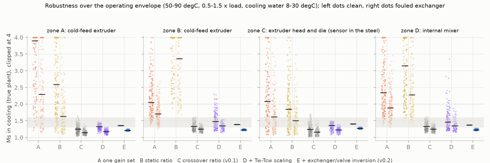
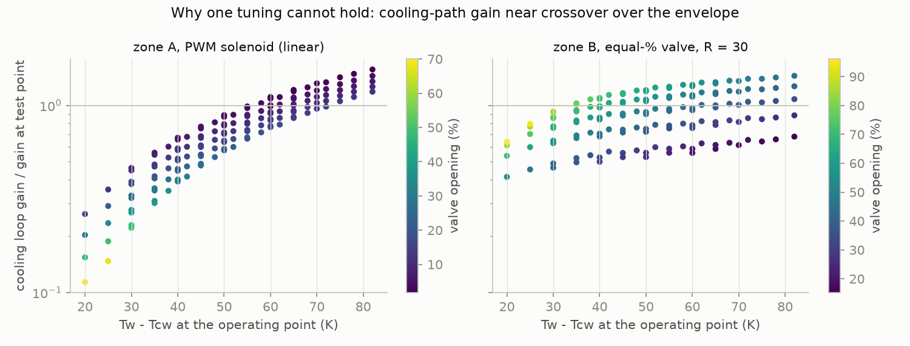
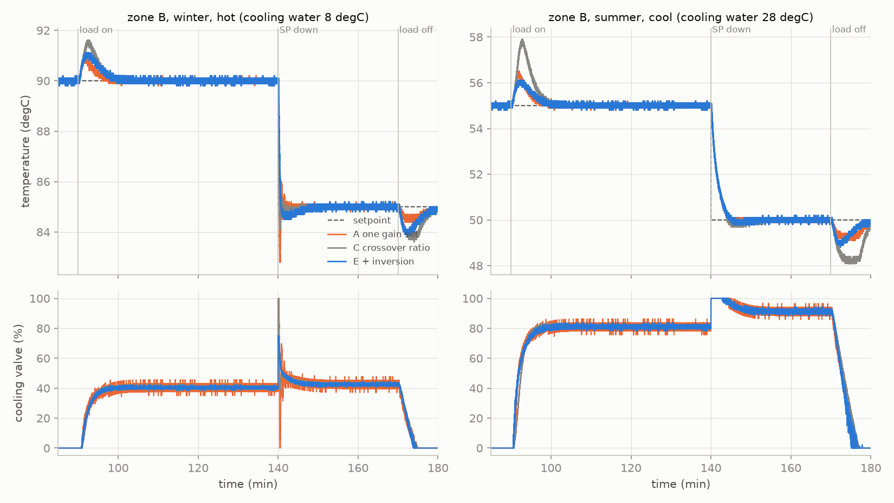
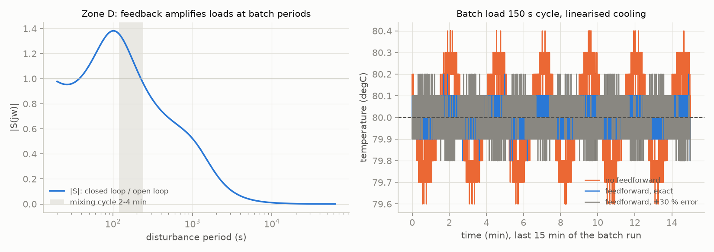
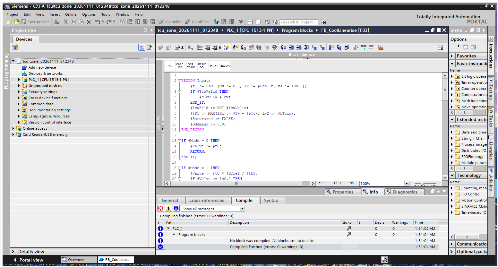

# tcu-zone-pid-tuning

This project tunes the zones of a heating/cooling **temperature control unit (TCU)** on a
rubber-compound line (cold-feed extruder barrel and screw, extruder head, internal-mixer wall) and
answers why such zones behave badly only *in some cases*. The zone model is derived from the
hardware with textbook heat transfer (closed primary water circuit, plate heat exchanger by
effectiveness-NTU, cooling-water valve), the tuning tool works from three short technician tests, and
the controller is Siemens **SCL** compiled in **TIA Portal V18**. The work is laid out as a
systems-engineering dossier that follows Wasson's spine.

- **Read first:** [DOSSIER.md](DOSSIER.md) ([PDF](docs/DOSSIER.pdf)): need, ConOps, modes,
  requirements, architecture, interfaces, budgets, M&S, FMEA, trade study, V&V and line-trial plan.
- **Numbers:** [results/study.md](results/study.md) and [results/aoa.md](results/aoa.md).
- **Traceability:** [TRACEABILITY.md](TRACEABILITY.md).
- **Data:** everything here is **simulation**. No data from a real TCU, no PLCSIM run. Every
  parameter is tagged std / derived / assumed ([DOSSIER §8.2](DOSSIER.md)).

**Question.** A split-range PI per zone, tuned at one test point, holds well at some operating
conditions and oscillates or responds slowly at others. What moves under the controller, and what is
the smallest change that keeps one tuning robust over the whole operating envelope (setpoint
50–90 °C, process load 0.5–1.5 ×, cooling water 8–30 °C over the year, exchanger clean to fouled)?

**Alternatives for the cooling path.** A one gain set for heating and cooling; B static gain ratio;
C ratio taken at the loop's crossover frequency (this tool, v0.1); D C plus scaling by Tw − Tcw;
E C plus an inversion of the valve + plate-exchanger model in the PLC (`FB_CoolLinearise`, v0.2).



## Findings

Simulation of four zones (extruder barrel, extruder screw, extruder head with the sensor in the steel,
internal-mixer wall) with noise and 0.1 K resolution. Each zone is tuned by the tool from simulated
technician tests at one test point (80 °C, full process load, cooling water 15 °C), then checked on the
true linearised plant at about 150 operating points per zone, clean and fouled, and in the time domain
at a winter and a summer corner.

1. **"In some cases" is the cooling path moving under the controller.** Near the loop's crossover
   frequency the cooling-path gain changes by a factor of **13.7–25** over the envelope on zones with a
   linear (PWM solenoid) valve, and **3.5–3.6** on zones with an equal-percentage valve
   (Tw − Tcw 13–82 K, valve 2–96 %). The heating path does not move. Two causes, both physical: the
   heat removed scales with Tw − Tcw (setpoint and cooling-water season), and the plate exchanger's
   effectiveness-NTU curve bends the valve characteristic.

   

2. **One gain set limit-cycles; the "obvious" fix makes it worse.**
   - **One gain set (A):** Ms > 2 at **53–86 %** of the envelope points. At the test point zone A
     already limit-cycles: 707 heater/valve switchovers in a 3.3 h run, valve slamming 0–100 %.
   - **Static gain ratio (B):** on the equal-percentage zones the identified static ratio is below 1
     (0.49 and 0.75), because the open valve also adds conductance and lowers the static gain, while
     at crossover the cooling path is 2.4–2.6 × stronger. Ms > 2 at **84–99 %** of points there.
3. **The crossover ratio (C, this tool's v0.1) is never unstable but becomes slow.** Ms stays at
   **1.02–1.70** everywhere, but 9–39 % of the points sit below Ms 1.2 (sluggish), and in the summer
   corner the load-step peak grows to **2.9 K** on zones A and B (1.2–1.6 K at the test point).
4. **Inverting the valve + exchanger model in the PLC (E, v0.2) holds one tuning everywhere.**
   - **Robustness:** Ms **1.36–1.41** at every envelope point of every zone with a clean exchanger;
     **1.19–1.33** when it is fouled (Rf 0.000176 m²K/W, the model left clean): fouling only makes it
     more cautious.
   - **Corners:** load-step peaks 1.4–1.7 K (A), 0.9–1.1 K (B), 1.8–2.2 K (D), against up to 2.9 / 2.9 /
     4.2 K for C.
   - **Cost:** one cooling-water Pt100 per TCU and the nameplate data of the exchanger and valve.
     Scaling by Tw − Tcw alone (D) is enough for linear valves but not for equal-percentage ones
     (Ms up to 3.35).
   - **A defect it exposed:** when the linearised valve saturates before the PID's own limit, the PID
     winds up; the summer setpoint drop overshot by 1.6–1.8 K. Conditional integration from the block's
     `Saturated` flag brought it to 0.2–0.4 K.

   

5. **Feedforward from the process power is the lever that tuning cannot replace.**
   - **Mixer wall (D):** at a 150 s batch cycle the loop *amplifies* the load (|S| = 1.25; |S| > 1 for
     periods of 38–224 s). Feedforward from the rotor power halves the ripple, 0.8 → 0.4 K peak-to-peak,
     and with a ±30 % wrong gain it is still 0.4–0.5 K.
   - **Head zone (C), sensor in the steel:** no cooling option meets the 2 K load-step limit (peak
     6.5 K with E), because the load enters the steel where the sensor sits. Feedforward brings it to
     **2.6 K** (2.3–3.4 K with ±30 % gain error); a cascade on the water temperature is the next step.

   

6. **Trade study:** E 80.2, C 77.4, D 43.9, B 35.5, A 33.7 (weighted figure of merit). The margin is
   small: C wins if cost weighs 27 of 100 or more, or if the sensor and engineering cost doubles.
   So: **C now on every zone (no hardware), E where the cooling water swings with the season or the
   valves are equal-percentage.**
7. **Identification (from v0.1, still true):** with the sensor in the water the FOPDT fit finds no dead
   time (L = 0 s on three zones), so ZN, SIMC and AMIGO would give infinite gain; the tool refuses them
   and fits a lead-lag model with dead time (RMSE 0.057–0.058 K vs 0.121–0.160 K).

   

8. **PLC fit.** `FB_ZonePID`, `FB_CoolLinearise`, the simulation FBs, the DBs and OB30 at 100 ms
   compile in TIA Portal V18 (CPU 1513-1 PN) with **0 errors and 0 warnings**. Upper-bound cost
   0.64 ms per zone per cycle (16 model evaluations with EXP/LN). The compiler found one more thing:
   `100.0 * 0.5 * (...)` is folded into an LReal constant and draws an "accuracy may be lost" warning.

   

**What is not done:** PLCSIM (the S7-PLCSIM V18 installer is on the PC, but it stops on a pending
Windows restart), execution time on a real CPU, any real TCU. The line-trial plan is in
[DOSSIER §11.3](DOSSIER.md).

## What is in the repo

| Path | Content |
|---|---|
| `src/tcutune/physics.py` | Zone parameters from hardware: water properties, Gnielinski film coefficient, steel conduction, ε-NTU plate exchanger, valve characteristics, transport delay |
| `src/tcutune/plant.py` | Two-mass zone simulator (water circuit + machine part), split range, exchanger cooling, dead time, sensor lag, noise |
| `src/tcutune/identify.py`, `tuning.py`, `tool.py`, `cli.py` | Identification (FOPDT, lead-lag with dead time, relay), tuning rules with Ms check, crossover cooling ratio, the `tcu-tune` CLI |
| `src/tcutune/linearise.py` | Reference model of `FB_CoolLinearise` (modes 0/1/2) |
| `src/tcutune/envelope.py` | Linearisation of the true plant at any operating point, Ms over the envelope, fouling |
| `src/tcutune/scl.py` | Translator that runs the SCL in Python with float32 Real (CI runs the exact TIA source) |
| `plc/FB_ZonePID.scl` | Split-range PI(D): setpoint weight, filtered D, back-calculation and conditional anti-windup, bumpless manual, lagged feedforward |
| `plc/FB_CoolLinearise.scl` | Cooling demand → valve: Tw − Tcw scaling or valve + exchanger model inversion (bisection), Tcw fault hold |
| `plc/FB_ZonePlant.scl`, `FB_Scenario.scl`, `FB_ZoneTest.scl`, `plc/tia/` | The zone simulated inside the PLC for PLCSIM; OB30 (100 ms) and DBs |
| `scripts/run_study.py`, `scripts/aoa.py` | Whole study → `results/`, `docs/img/`; trade study → `results/aoa.md` |
| `scripts/tia_*.ps1`, `scripts/export_pdf.py` | TIA Openness build, OB30 conversion, screenshot; DOSSIER.md → PDF |

## Run it

```bash
pip install -e .[test]
python -m pytest -q                       # physics, plant, tool, SCL equivalence in float32
tcu-tune nameplate --zone A               # FB_CoolLinearise settings from the TCU hardware
tcu-tune demo data --lin 2                # simulated technician tests (cooling through the linearisation)
tcu-tune batch data --out results/recommended.csv
python scripts/run_study.py               # about 40 min on a laptop; --quick for a smoke run
python scripts/aoa.py
```

```powershell
powershell -ExecutionPolicy Bypass -File scripts\tia_build.ps1 -OutDir C:\TIA_tcu
powershell -ExecutionPolicy Bypass -File scripts\tia_ob30.ps1  -Project <path.ap18>
powershell -ExecutionPolicy Bypass -File scripts\tia_screenshot.ps1 -Project <path.ap18> -Block FB_CoolLinearise -Out docs\img\tia_FB_CoolLinearise.png
```

## Licence

MIT, see [LICENSE](LICENSE).
